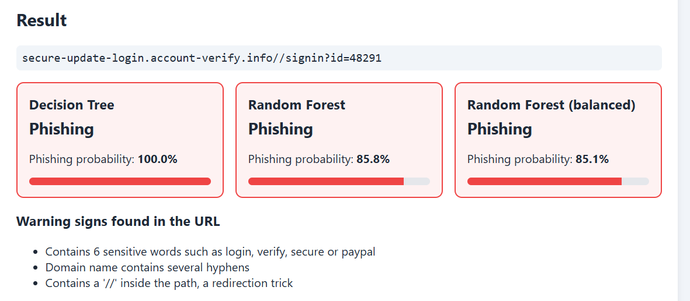
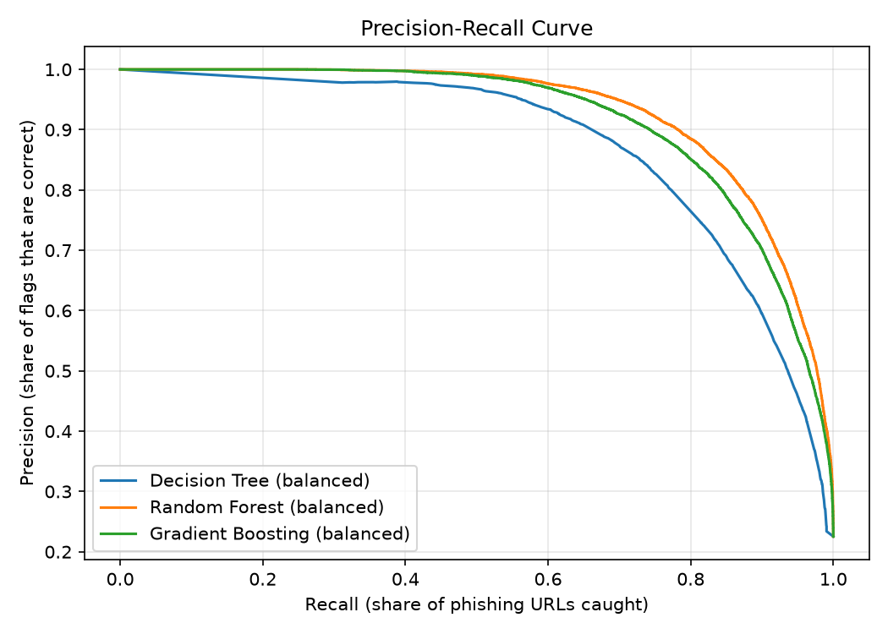

# Phishing Website Detection


A machine learning project that classifies URLs as phishing or legitimate. It compares a **Decision Tree** with a **Random Forest** (plus Gradient Boosting as an extra baseline) and serves them through a **Flask** web app with an adjustable alert threshold.

Built for the *Machine Learning Techniques* course. Python, scikit-learn, Flask, HTML and CSS. Runs fully on a local laptop at no cost.



## Results

Evaluated on a held-out 20% test set (101,439 URLs, 22.5% phishing).

| Model | Test accuracy | Precision | Recall | F1-score |
|---|---|---|---|---|
| Decision Tree | 91.37% | 87.51% | 71.99% | 0.790 |
| Random Forest | 93.01% | 91.81% | 75.75% | 0.830 |
| Decision Tree (balanced) | 88.17% | 69.51% | 84.64% | 0.763 |
| Random Forest (balanced) | 91.93% | 78.64% | 88.15% | 0.831 |
| Gradient Boosting (balanced) | 90.22% | 73.65% | 88.13% | 0.802 |

"Balanced" means `class_weight="balanced"`, which makes missing a phishing URL cost more during training.

**Main findings**
- Random Forest beats a single Decision Tree on every measure. Averaging many varied trees reduces overfitting.
- Accuracy alone is misleading here. A model that always answers "legitimate" scores about 77.5%.
- Balanced training raised the Random Forest's recall from 75.8% to 88.2%, but lowered precision from 91.8% to 78.6%. This is the precision/recall trade-off, and the app's threshold slider lets the user choose where to sit.
- 5-fold cross-validation agrees with the single split (balanced Random Forest F1 = 0.832, standard deviation 0.0013), so the results are stable.



## How it works

1. **Clean the data** (`preprocess.py`): remove 42,150 duplicate rows and 2 URLs with conflicting labels, leaving 507,191 URLs.
2. **Extract 24 features from the URL text** (`feature_extractor.py`): lengths, character counts, subdomain count, IP address, `@` symbol, `//` in the path, URL shorteners, sensitive words such as *login* and *verify*, and Shannon entropy.
3. **Train and evaluate** (`train_models.py`, `improve_models.py`): 80/20 stratified split, precision, recall, F1, confusion matrices, 5-fold cross-validation and a precision-recall curve.
4. **Serve** (`app.py`): the same feature function runs on any submitted URL, and each model returns a phishing probability.

The scanner only analyses the URL as text. It never visits the website.

## Dataset

"Phishing Site URLs" on [Kaggle](https://www.kaggle.com/) (author: Tarun Tiwari), 549,346 labelled URLs. The data is not included in this repository.

## Run it yourself

```powershell
git clone https://github.com/muhammedaslamns/phishing-url-detector.git
cd phishing-url-detector
python -m venv venv
.\venv\Scripts\Activate.ps1
pip install -r requirements.txt
```

1. Download the dataset from Kaggle and save it as `data/archive/phishing_site_urls.csv`.
2. Generate the features and train the models:

```powershell
python preprocess.py
python train_models.py
python improve_models.py
```

3. Start the app and open http://127.0.0.1:5000:

```powershell
python app.py
```

4. Run the tests:

```powershell
python -m pytest -v
```

## Project structure

```
├── app.py                  Flask web app
├── feature_extractor.py    URL to 24 numeric features
├── preprocess.py           Cleaning and feature extraction
├── train_models.py         Decision Tree and Random Forest
├── improve_models.py       Balanced models, Gradient Boosting, cross-validation
├── templates/index.html    Web page
├── static/                 CSS and charts
├── models/                 Results tables (model files are generated locally)
├── tests/                  Unit tests for the feature extractor
└── docs/                   Screenshots
```

## Limitations

- Even the best model misses about 12% of phishing URLs at the balanced setting (about 24% in the standard setting).
- Only the URL text is used. Page content, domain age and SSL certificate details are not.
- The dataset may contain biases, so unusual legitimate URLs can be flagged and short, clean-looking phishing URLs can pass.
- A "legitimate" result is not a guarantee of safety. This is a student project, not a security product.

## Future work

- Add domain-age and page-content features
- Hyperparameter tuning and a larger model comparison
- Explain individual predictions with SHAP
- Deploy a hosted demo

## License

MIT, see [LICENSE](LICENSE).
